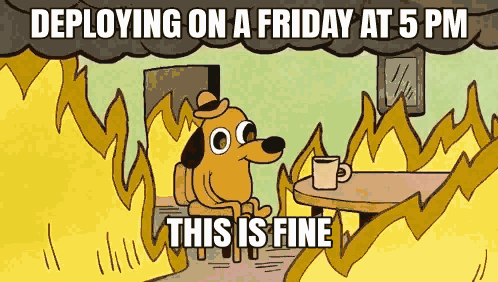

<p align="center">
  
</p>

<p align="center">
  <b>Give your AI agent a way to make memes.</b><br>
  <sub>The punchline is still your responsibility.</sub>
</p>

<p align="center">
  <a href="https://github.com/MrHydeDev/meme-studio-mcp-plugin/actions/workflows/validate.yml"></a>
  <a href="LICENSE"></a>
  <a href="https://agent-plugins.org/specification"></a>
  <a href="mcp.json"></a>
</p>

### `hyde@sunnydale:~$` cat README.md

Connect Hermes, Cursor, Codex, Copilot or another MCP client to [Meme Studio](https://memes.mrhyde.dev/en/).
It's a meme editor that runs entirely in the browser, without accounts, with **more than a thousand templates, hundreds of
them animated**. Your own photos work too.

Your agent finds a template for the joke, writes the captions and returns the image (a GIF for animated
templates), plus a link to tweak it and download it in the editor.

<p align="center">
  <br>
  <sub>Made by an agent with this plugin. No dogs were harmed.</sub>
</p>

### `hyde@sunnydale:~$` hermes plugins install meme-studio-mcp

Once the plugin is in the [Hermes](https://hermes-agent.nousresearch.com) catalog:

```bash
hermes plugins install meme-studio-mcp
hermes plugins enable meme-studio-mcp
```

Portable plugins install disabled, so both commands matter.

Other MCP clients can connect directly to `https://memes.mrhyde.dev/mcp` using **Streamable HTTP**.
No sign-in or keys. The server is listed in the official MCP registry as `dev.mrhyde/memes`.

This is an [Agent Plugins v1](https://agent-plugins.org/specification) package:
[`plugin.json`](plugin.json), [`mcp.json`](mcp.json) and one [skill](skills/meme-studio/SKILL.md).
It contains configuration only, with no code of its own, and passes `hermes plugins validate`.

### `hyde@sunnydale:~$` cat prompts.txt

- "Make a meme about my code working locally but not in production"
- "Make me an animated GIF of someone losing it because the wifi dropped"
- "Make a meme with this photo about meetings that could have been an email"
- "Hazme un meme sobre los lunes por la mañana"

### `hyde@sunnydale:~$` man meme-studio

All five tools are read-only: they don't change anything on the server.

| Tool | What it does |
| --- | --- |
| `suggest_templates` | Finds templates that fit a joke or situation, with hints for each caption slot and how many characters fit. |
| `search_templates` | Searches by name, keywords or what a meme is used for. |
| `get_template` | Gets a template and its caption slots. |
| `popular_templates` | Shows the most used this week or overall, or the latest additions. |
| `create_meme` | Renders a template or your own photo as a preview or final image, with an editor link. Animated templates return a GIF. |

Usage limits apply per person and across the service. A `busy` or `rate_limited` response tells you when to retry.

### `hyde@sunnydale:~$` cat data-notice.txt

**This is a remote-only connector. Every tool call goes to `memes.mrhyde.dev`.**

- What your agent sends (searches, captions, your handle, photos or photo URLs) is used to make the meme and
  is not stored or logged. The meme is not stored either: the edit link carries it.
- With `image_url`, the server downloads the photo itself, over HTTPS and from public addresses only.
- The server keeps daily aggregate counts: requests by type, distinct people without identifying them,
  agent types, tools and options, chosen templates, errors and warnings. No IP addresses are kept, except
  for temporary abuse blocks. It also keeps the minimal technical logs needed to run the service.
- The [public stats](https://memes.mrhyde.dev/en/stats) group these counts by week, with no figures below 5.
- Finished memes carry an invisible mark in the pixels indicating whether an image came from Meme Studio.
  It offers no protection and is not proof of authorship.
- The full legal notice is linked in the [website footer](https://memes.mrhyde.dev/en/).

### `hyde@sunnydale:~$` cat LICENSE

This package is [MIT licensed](LICENSE). Meme Studio and its server are not open source.
Templates belong to their owners, who can ask for theirs to be removed.

---

<p align="center">
  <a href="https://github.com/MrHydeDev/meme-studio-mcp-plugin/issues">Support: open an issue</a> |
  <a href="https://mrhyde.dev">mrhyde.dev</a>
</p>